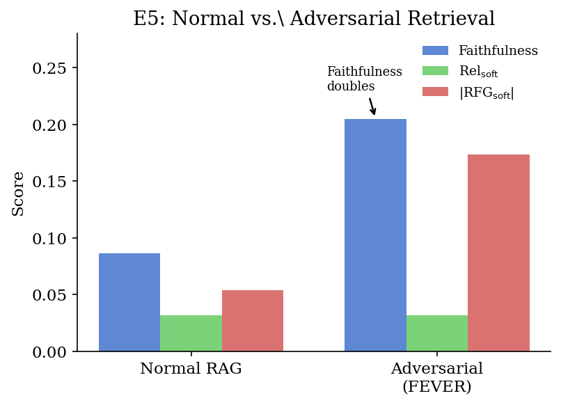
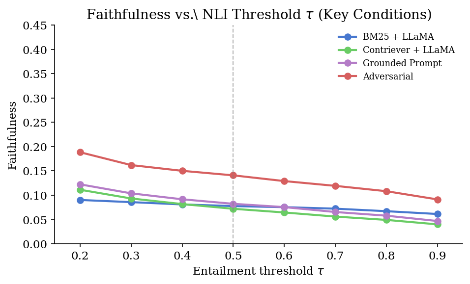

# Evaluating Faithfulness and Attribution in Retrieval-Augmented Generation Systems

**Independent research project — Srinivasa Sai Chava (2026)**

Developed by Srinivasa Sai Chava using a personally funded Google Colab Pro account. The author confirms this was a solo project completed on Google Colab Pro.

> *Does a RAG system actually use its retrieved documents, or does it silently fall back on parametric memory?*

[](https://www.python.org/)
[](LICENSE)
[]()

---

## Overview

We present a comprehensive empirical evaluation of **faithfulness and attribution** in RAG systems using NLI-based support scores and five experimental comparisons. Our pipeline measures whether language model outputs are actually grounded in retrieved evidence — not just whether they are factually correct.

### Key Findings

| Finding | Result |
|---|---|
| Plain prompting faithfulness | ~0.08–0.10 (very low) |
| Grounded prompt vs. Plain | +12% relative faithfulness |
| Chain-of-Thought vs. Plain | **−24% relative** (counterintuitive) |
| FEVER distractor insertion | Reported NLI support score increases; interpretation requires further validation |
| Manual review | 50 examples, two labeling passes by the same author |
| NLI vs. manual reference labels (κ) | **−0.18**, exploratory single-annotator comparison |

---

## Evaluation limitations

- Both annotation files were created by the same person. Reported agreement is within-annotator consistency, not independent inter-annotator agreement.
- The current `attribution_precision` implementation is mathematically equivalent to the support-based faithfulness score. It is not a distinct citation-attribution metric.
- FEVER claims are sampled randomly, rather than being matched contradictions for each question. Treat E5 as a distractor-insertion experiment.
- RFG is a descriptive difference between proportions; its sign is not causal evidence about model behavior. E1/E2 differences above were corrected by subtracting the displayed means; original outputs were not regenerated.
- Results are preliminary project findings, not peer-reviewed validation.

## Pipeline Architecture

```
Query
  │
  ▼
Retriever (BM25 or Contriever)
  │  top-k passages
  ▼
Generator (LLaMA-3.1-8B or Mistral-7B)
  │  generated answer
  ▼
Claim Extractor (sentence splitter)
  │  {c₁, c₂, ..., cₙ}
  ▼
NLI Scorer (cross-encoder/nli-deberta-v3-base)
  │  entailment probabilities
  ▼
Metrics: Faithfulness · Soft Rel · RFG
```

---

## Metrics

Reported diagnostic scores defined at the claim level using NLI entailment probability (τ = 0.5):

**Faithfulness** — fraction of generated claims supported by at least one retrieved passage:

$$\text{Faithfulness}(a, \mathcal{D}) = \frac{|\{c_i : \exists\, d_j,\; \text{nli}(d_j, c_i) > \tau\}|}{|\mathcal{C}(a)|}$$

**Soft NLI Retrieval Relevance** — fraction of passages that semantically entail the gold answer:

$$\text{Rel}_\text{soft}(\mathcal{D}, q) = \frac{|\{d_j : \text{nli}(d_j, a^*) > \tau\}|}{|\mathcal{D}|}$$

**Retrieval-Faithfulness Gap (RFG)** — measures the grounding gap:

$$\text{RFG} = \text{Rel}_\text{soft}(\mathcal{D}, q) - \text{Faithfulness}(a, \mathcal{D})$$

RFG subtracts proportions with different denominators. Its sign alone does not establish whether a generator ignored retrieval, used parametric memory, or achieved ideal grounding.

---

## Experiments

| Exp | Variable | Dataset | N |
|---|---|---|---|
| E1 | Retriever: BM25 vs. Contriever | NQ | 1,000 |
| E2 | Generator: LLaMA vs. Mistral | NQ | 1,000 |
| E3 | Prompt: Plain vs. Grounded vs. CoT | NQ | 500–1,000 |
| E4 | Top-k: k ∈ {1, 3, 5, 10} | NQ | 500 |
| E5 | Adversarial FEVER passages | NQ | 500 |
| — | Multi-answer evaluation | ASQA | 500 |

---

## Results

### E1 & E2 — Retriever and Generator Comparison

| Condition | Retriever | Generator | Faith | Rel_soft | RFG_soft |
|---|---|---|---|---|---|
| No-RAG | None | LLaMA | 0.000 | 0.000 | 0.000 |
| E1 | BM25 | LLaMA | 0.082 | 0.003 | −0.079 |
| E1 | Contriever | LLaMA | 0.095 | 0.016 | −0.079 |
| E2 | Contriever | LLaMA | 0.097 | 0.016 | −0.081 |
| E2 | Contriever | Mistral | 0.078 | 0.016 | −0.062 |

### E3 — Prompt Style Ablation

| Prompt Style | N | Faith | Rel_soft | RFG_soft |
|---|---|---|---|---|
| Plain | 1,000 | 0.089 | 0.032 | −0.057 |
| **Grounded** | 1,000 | **0.100** | 0.032 | −0.068 |
| CoT | 500 | 0.068 | 0.032 | −0.036 |

### E4 — Top-k Ablation

| k | Faith | Rel_soft | RFG_soft |
|---|---|---|---|
| 1 | 0.091 | 0.022 | −0.069 |
| 3 | 0.094 | 0.028 | −0.066 |
| 5 | 0.098 | 0.032 | −0.066 |
| **10** | **0.147** | 0.029 | **−0.117** |

### E5 — Adversarial Retrieval

| Condition | N | Faith | Rel_soft | RFG_soft |
|---|---|---|---|---|
| Normal RAG | 500 | 0.086 | 0.032 | −0.054 |
| **Adversarial (FEVER)** | 500 | **0.205** | 0.032 | **−0.173** |

The reported NLI support score increases after distractor insertion. The current implementation randomly samples FEVER claims without matching them to the question, so this comparison does not establish robustness to question-specific contradictory evidence or a causal calibration failure.

---

## Figures

### E5: Adversarial Retrieval — Calibration Failure



### Faithfulness vs. NLI Threshold τ



---

## Human Evaluation

The author created both annotation files for the same 50 examples. They represent two labeling passes by one person, not two independent annotators. Agreement between these files must not be reported as inter-annotator agreement. Manual comparisons are exploratory and require independent annotation for stronger conclusions.

| Condition | N | Manual Faithful | κ(Reference pass, NLI) |
|---|---|---|---|
| E1 / BM25 | 17 | 64.7% | −0.12 |
| E3 / Grounded | 17 | 94.1% | +0.01 |
| E5 / Adversarial | 16 | 43.8% | −0.31 |
| **Overall** | **50** | **68.0%** | **−0.18** |

---

## Repository Structure

```
├── rag_eval/
│   ├── pipeline.py                  # Core RAG pipeline (retrieve → generate → score)
│   ├── metrics.py                   # Faithfulness, Soft Rel, RFG (Eqs. 1–3)
│   ├── config.py                    # Paths, model names, hyperparameters
│   ├── analyze_results.py           # Aggregate and compare experiment outputs
│   ├── plot_results.py              # Generate figures
│   ├── compute_kappa.py             # Within-annotator labeling-pass agreement
│   ├── retrievers/
│   │   ├── bm25_retriever.py        # BM25Okapi over Wikipedia passages
│   │   ├── contriever_retriever.py  # facebook/contriever + FAISS index
│   │   └── dpr_retriever.py         # DPR retriever (baseline)
│   ├── generators/
│   │   ├── hf_generator.py          # LLaMA-3.1-8B / Mistral-7B (4-bit NF4)
│   │   └── gpt_generator.py         # GPT-based generator (optional)
│   ├── data/
│   │   ├── nq_loader.py             # Natural Questions via HuggingFace
│   │   ├── asqa_loader.py           # ASQA multi-answer dataset
│   │   ├── fever_loader.py          # FEVER refuting passages (E5)
│   │   ├── build_contriever_index.py # Build FAISS index
│   │   └── download_all.py          # Download all datasets
│   └── experiments/
│       ├── run_e1_retriever.py      # E1: BM25 vs Contriever
│       ├── run_e2_generator.py      # E2: LLaMA vs Mistral
│       ├── run_e3_prompt.py         # E3: Plain / Grounded / CoT
│       ├── run_e4_topk.py           # E4: k ∈ {1,3,5,10}
│       ├── run_e5_adversarial.py    # E5: Adversarial FEVER
│       └── run_asqa.py              # ASQA evaluation
├── jobs/                            # optional scheduler and local runner templates
│   ├── run_e1_e2.sh
│   ├── run_final.sh
│   ├── run_final_interactive.sh
│   ├── build_contriever_index.sh
│   ├── download_data.sh
│   └── setup_env.sh
├── figures/                         # Generated plots
│   ├── fig1_e3_prompt.png
│   ├── fig2_e4_topk.png
│   ├── fig3_e5_adversarial.png
│   └── fig4_tau_sensitivity.png
├── human_eval_annotator1.csv        # First labeling pass by the author (50 examples)
├── human_eval_annotator2.csv        # Second labeling pass by the same author (50 examples)
├── human_eval_sample.json           # Sampled examples with NLI scores
└── requirements.txt                 # Python dependencies
```

---

## Installation

```bash
git clone https://github.com/Chava-Sai/Evaluating-Faithfulness-and-Attribution-in-Retrieval-Augmented-Generation-Systems.git
cd Evaluating-Faithfulness-and-Attribution-in-Retrieval-Augmented-Generation-Systems

# Create environment
conda create -n rag_eval python=3.10 -y
conda activate rag_eval

# Install dependencies
pip install -r requirements.txt
```

**Requirements:** Python 3.10+, CUDA GPU recommended. The author used Google Colab Pro; GPU availability varies by session. Scheduler templates are optional portability examples, not a record of institutional computing access.

---

## Usage

### 1. Download Data & Build Index

```bash
python rag_eval/data/download_all.py
python rag_eval/data/build_contriever_index.py   # builds FAISS index (~1M passages)
```

### 2. Run Experiments

```bash
# E1: Retriever comparison (BM25 vs Contriever)
python rag_eval/experiments/run_e1_retriever.py

# E2: Generator comparison (LLaMA vs Mistral)
python rag_eval/experiments/run_e2_generator.py

# E3: Prompt style ablation (Plain / Grounded / CoT)
python rag_eval/experiments/run_e3_prompt.py

# E4: Top-k ablation
python rag_eval/experiments/run_e4_topk.py

# E5: Adversarial retrieval (FEVER passages)
python rag_eval/experiments/run_e5_adversarial.py
```

### 3. Analyze & Plot

```bash
python rag_eval/analyze_results.py
python rag_eval/plot_results.py
```

### 4. Manual review and within-annotator consistency

```bash
python rag_eval/compute_kappa.py \
    --ann1 human_eval_annotator1.csv \
    --ann2 human_eval_annotator2.csv \
    --sample human_eval_sample.json
```

### 5. Optional scheduler templates (SLURM/SGE)

```bash
qsub rag_eval/jobs/run_final.sh
# or
sbatch rag_eval/jobs/run_final.sh
```

---

## Models

| Component | Model |
|---|---|
| Retriever (dense) | `facebook/contriever` |
| Retriever (sparse) | BM25Okapi (`rank_bm25`) |
| Generator | `meta-llama/Meta-Llama-3.1-8B-Instruct` |
| Generator | `mistralai/Mistral-7B-Instruct-v0.3` |
| NLI Scorer | `cross-encoder/nli-deberta-v3-base` |
| Passage Corpus | Wikipedia DPR 100-word passages (21M passages) |

All generator models run with **4-bit NF4 quantization** via `bitsandbytes`.

---

## Author

- **Srinivasa Sai Chava** — Research design, implementation, training, evaluation, and analysis.
- **Computing:** Google Colab Pro (personal account).

Author and computing metadata were corrected on 27 October 2026 following confirmation by the project author. Existing experiment outputs are retained without changing their numerical results.

---

## Citation

```bibtex
@article{chava2026ragfaithfulness,
  title     = {Evaluating Faithfulness and Attribution in
               Retrieval-Augmented Generation Systems},
  author    = {Chava, Srinivasa Sai},
  year      = {2026},
  note      = {Independent research project; unpublished}
}
```
